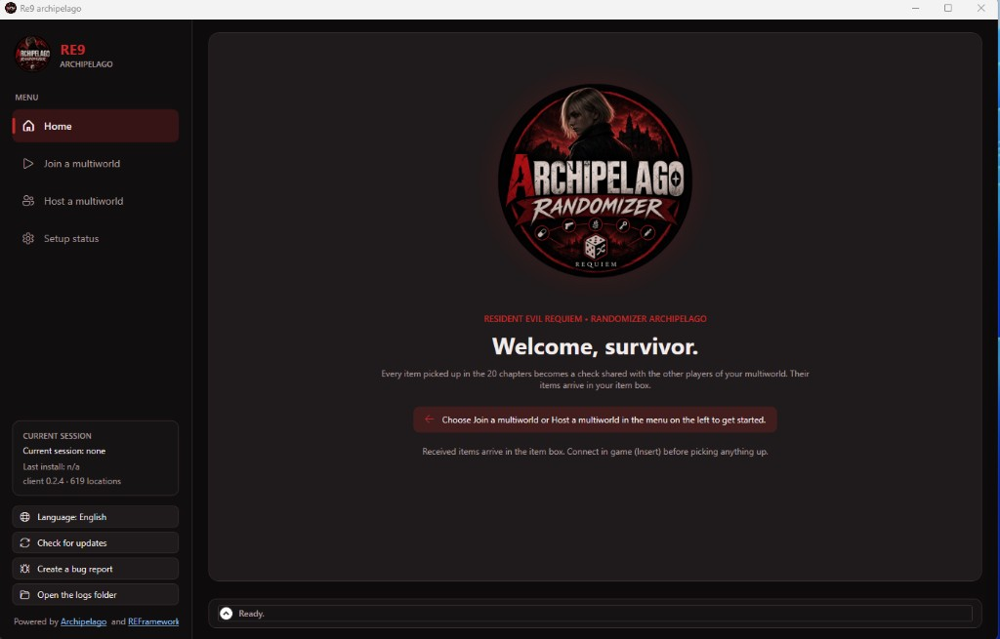
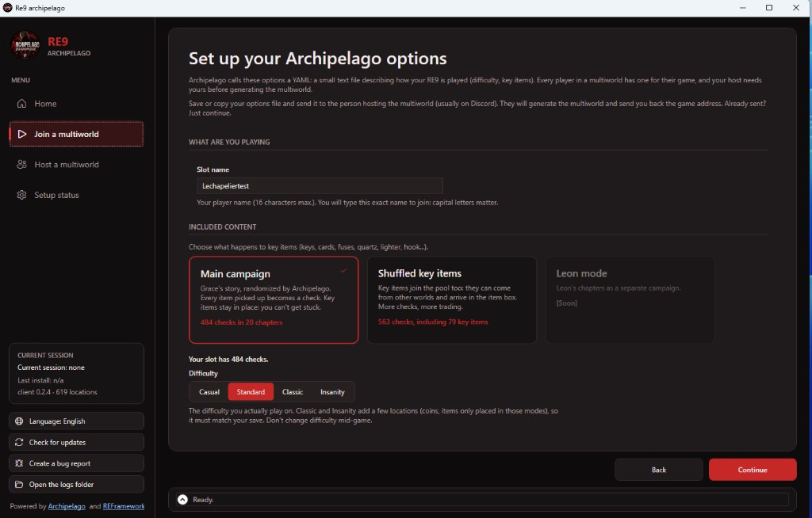
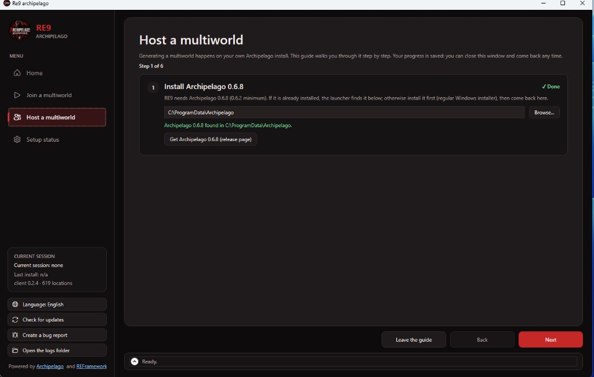
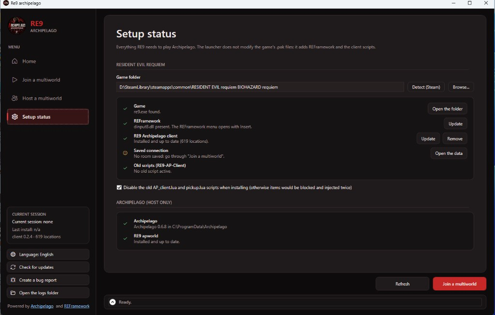

# Re9 archipelago — 1.0.0 (alpha)

Randomizer [Archipelago](https://archipelago.gg) pour **Resident Evil Requiem** (RE9).

Les objets posés dans le monde deviennent des checks partagés avec les autres joueurs du multimonde.
Ramasser un objet envoie son check ; ce que tu trouves peut appartenir à un autre joueur, et tes propres
objets peuvent être trouvés dans d'autres jeux.

> **Version alpha** : le mod est jouable du début à la fin, mais il peut rester des bugs.
> Fais une sauvegarde de tes parties RE9 avant de jouer.

## Ce que contient le mod

- **Lanceur « Re9 archipelago »** (Windows) : rejoindre ou héberger un multimonde, installer REFramework,
  le client en jeu et l'apworld, vérifier la configuration, et recevoir les mises à jour avec le bouton
  **Mettre à jour**. En français ou en anglais.
- **Client en jeu** (script REFramework) : connexion au serveur, envoi des checks, réception des objets.
- **apworld `resident_evil_requiem`** : le monde Archipelago pour générer les parties.

## Captures d'écran

| Accueil du lanceur | Options du joueur (YAML) |
|---|---|
|  |  |
| **Héberger un multimonde** | **État de la configuration** |
|  |  |

**Client en jeu** (menu REFramework, touche Insert) :


## Fonctionnement en jeu

- Les objets au sol, dans les tiroirs, coffres-forts, casiers, etc. des 20 chapitres sont des checks :
  **484 checks** en difficulté Standard avec les objets clés à leur place, **563** avec les objets clés
  mélangés (dont 79 objets clés). Classic et Insanity en ajoutent quelques-uns.
- Ramasser un check contenant **ton propre objet AP** te le donne directement dans l'inventaire
  (option ; s'il n'y a pas de place, il part au coffre).
- Ramasser un check contenant **l'objet d'un autre joueur** ne te donne pas l'objet du jeu d'origine.
- Les objets reçus des autres joueurs arrivent dans le **coffre** des salles de sauvegarde.
- Nom de l'objet et du joueur affiché au ramassage (« Trouvé : Herbe verte pour Bob »), dans la langue du jeu.
- Noms affichés au-dessus des checks proches pas encore faits (onglet Guidage).
- Notifications, bandeau de progression et fenêtre du client (touche **Insert**, menu REFramework),
  couleurs personnalisables, français / anglais.
- **Objectif** : battre le dernier boss, puis cliquer sur « Oui, j'ai battu le dernier boss » dans la
  fenêtre du client pour envoyer la victoire.

## Options du YAML

| Option | Valeurs | Effet |
|---|---|---|
| `game_difficulty` | `casual`, `modern` (défaut), `classic`, `insanity` | Doit correspondre à la difficulté de ta sauvegarde : certains objets n'existent que dans certaines difficultés. |
| `key_items` | `vanilla` (défaut), `shuffled` | `vanilla` : les objets clés restent à leur place, l'histoire ne peut pas être bloquée. `shuffled` : les objets clés sont mélangés dans le multimonde ; ceux d'un chapitre sont requis avant que ses checks soient dans la logique. |

Exemple :

```yaml
name: Joueur{number}
game: Resident Evil Requiem
requires:
  version: 0.6.2

Resident Evil Requiem:
  progression_balancing: 50
  accessibility: full
  game_difficulty: modern
  key_items: vanilla
```

## Installer

Prérequis : Resident Evil Requiem (Steam), Windows, et [Archipelago](https://github.com/ArchipelagoMW/Archipelago/releases) 0.6.2 ou plus récent pour héberger ou générer.

1. Télécharge le paquet du lanceur et décompresse-le où tu veux.
2. Lance `RE9.AP.Launcher.exe`.
3. Choisis **Rejoindre un multimonde** (ou **Héberger un multimonde**) et suis les étapes :
   le lanceur installe REFramework, le client et l'apworld.
4. En jeu, ouvre le menu REFramework (**Insert**) et connecte-toi **avant** de ramasser quoi que ce soit.

Les mises à jour arrivent ensuite dans le lanceur : bandeau « Mise à jour disponible » en haut,
bouton **Mettre à jour**.

## Limites connues (alpha)

- Les objets lâchés aléatoirement par les ennemis (munitions des zombies, etc.) ne sont pas des checks.
- Les armes n'ont pas de logique : elles sont mélangées comme le reste, sans garantie de les avoir tôt.
- Le mode `key_items: shuffled` est moins testé que `vanilla`.
- La victoire s'envoie à la main avec le bouton du client.

## Signaler un bug

Dans le lanceur, clique sur **Générer un rapport de bug** : un zip `RE9-bugreport-….zip` est créé
sur le bureau. Envoie-le avec une description de ce qui s'est passé.

## Remerciements

- [Archipelago](https://archipelago.gg)
- [REFramework](https://github.com/praydog/REFramework) par praydog
- Fuzzy, pour le client AP de RE2R qui sert de base au client
- Le RE4R AP Wizard, modèle du lanceur
